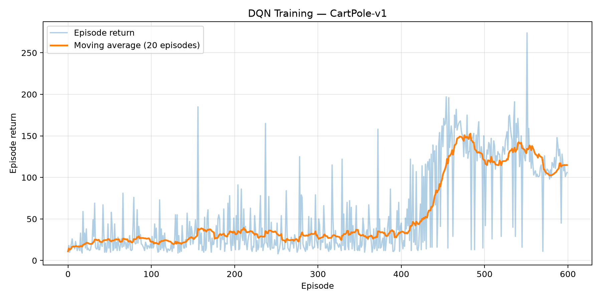
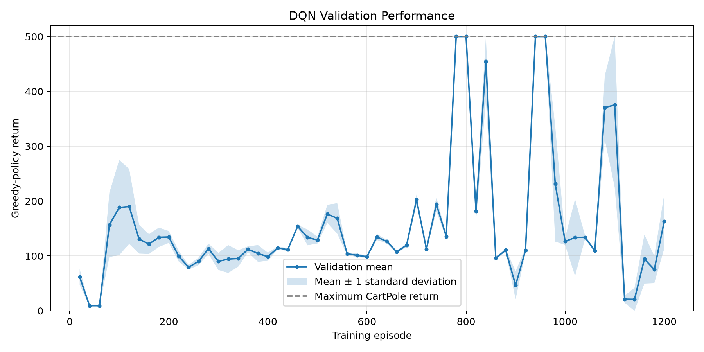
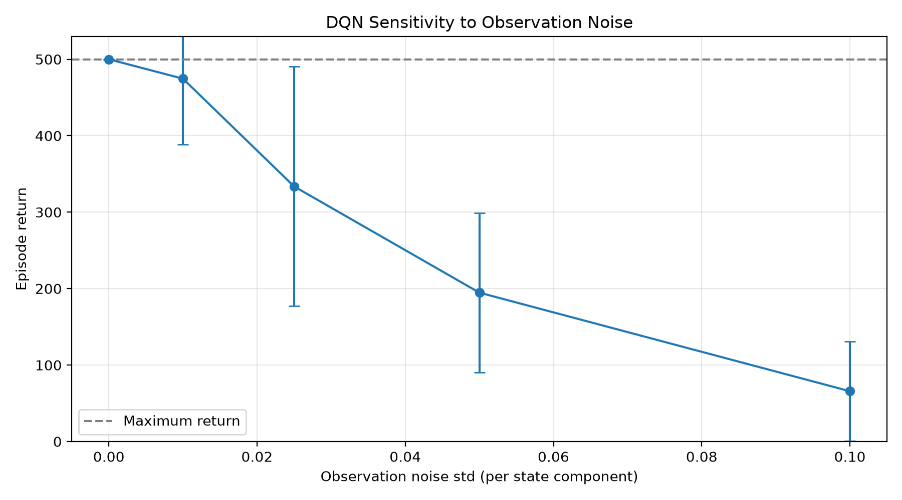
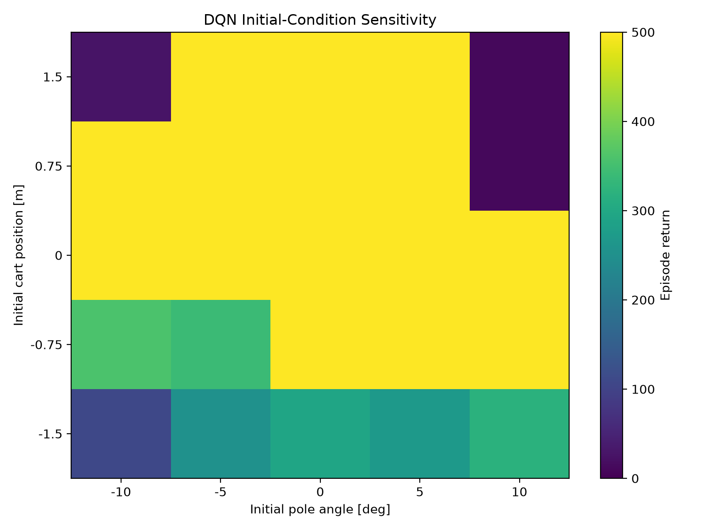

# RLControl — Deep Reinforcement Learning for CartPole Control

**An experimental study of Deep Q-Learning, training instability, checkpoint selection, and controller robustness.**

RLControl implements a **Deep Q-Network (DQN) from scratch in PyTorch** to control the inverted pendulum in Gymnasium's `CartPole-v1` environment. Beyond training an agent, this project investigates *when a learned controller succeeds, why it fails, and how experimental design affects reported performance*.

The project includes a random-policy baseline, reproducible training and evaluation scripts, periodic validation, multi-seed experiments, trajectory diagnostics, and robustness tests.

**Tech stack:** Python 3.11 · PyTorch · Gymnasium · NumPy · Matplotlib · pytest

## Key results

| Measure | Result |
|---|---:|
| Best single checkpoint, nominal test (100 episodes) | **500.00 / 500** mean return |
| Independent training seeds | **5** |
| Across-run mean test return — validation-selected checkpoints | **436.77 / 500** |
| Across-run mean test return — final checkpoints | **186.38 / 500** |
| Mean test success rate — selected checkpoints | **76.4%** |
| Mean test success rate — final checkpoints | **20.0%** |
| Best model success with observation noise (σ = 0.025) | **46%** |
| Initial-condition grid reaching 500 steps | **15 / 25** |

A **successful episode** reaches the environment's 500-step time limit. Results from the single best model should not be confused with reliability across independently trained models.

## Problem formulation

CartPole is an underactuated control task: a cart must move left or right to keep a hinged pole upright without leaving the track.

- **State:** cart position $x$, cart velocity $\dot{x}$, pole angle $\theta$, and angular velocity $\dot{\theta}$.
- **Action:** discrete left or right force, $a \in \{0,1\}$.
- **Reward:** +1 per environment step.
- **Episode end:** pole angle exceeds approximately ±12°, cart position exceeds ±2.4 m, or the 500-step time limit is reached.

The objective is to learn an action-value approximation $Q_\theta(s,a)$ and choose the action with the largest predicted value during evaluation.

## DQN implementation

The policy network is a fully connected multilayer perceptron:

```text
CartPole state (4)
       ↓
Linear (4 → 128) + ReLU
       ↓
Linear (128 → 128) + ReLU
       ↓
Linear (128 → 2)
       ↓
Q(left), Q(right)
```

Training uses:

- **Experience replay** to sample minibatches from past transitions.
- **Epsilon-greedy exploration** with a linear schedule.
- **A separate target network** updated periodically.
- **Huber loss**, Adam, and gradient clipping.
- **Termination-aware Bellman targets**: true terminations stop bootstrapping, while time-limit truncations do not.

The DQN regression target is

$$
y = r + \gamma (1-d)\max_{a'} Q_{\theta^-}(s',a'),
$$

where $d$ indicates environment termination, $\gamma$ is the discount factor, and $\theta^-$ denotes the target network parameters.

### Training configuration

| Parameter | Setting |
|---|---:|
| Learning rate | 0.001 |
| Discount factor | 0.99 |
| Replay buffer capacity | 100,000 |
| Minibatch size | 64 |
| Target-network update | Every 500 optimization steps |
| Epsilon schedule | 1.0 → 0.05 over 20,000 environment steps |
| Extended training | 1,200 episodes |
| Validation interval | Every 20 episodes |
| Validation | 20 greedy-policy episodes |

## Experiments and findings

### 1. Random baseline and initial DQN (EXP-001–003)

A 100-episode random-policy baseline achieved a mean return of **23.29** in the initial run. The first DQN trained for 600 episodes achieved **98.63 ± 1.88** during a separate 100-episode greedy-policy evaluation (versus a seeded random baseline of **22.52 ± 11.41**).

The first baseline did not explicitly seed the action space; subsequent evaluation scripts do.



*Training returns are collected under epsilon-greedy exploration and are not the same as independent greedy-policy evaluation returns.*

### 2. Diagnose control failure (EXP-004)

The initial model repeatedly failed near 100 steps. State-trajectory analysis for seeds 10000, 10025, and 10050 identified **cart-position constraint violations** as the cause. The pole remained inside its angular termination bounds, while the cart accumulated rightward velocity and drifted beyond +2.4 m.

This distinguishes temporary pole-angle stabilization from regulation of the full cart–pole state. Three trajectories support this diagnosis for the inspected episodes, not a universal claim about every possible initial state.

### 3. Longer training and checkpoint selection (EXP-005–006)

Extending training to 1,200 episodes produced periods of high return followed by severe degradation. Saving only the final model hid strong intermediate policies.

We therefore added **greedy-policy validation every 20 training episodes** and retained both the highest-validation checkpoint and the final checkpoint.

For training seed 42, the validation-selected model came from **episode 780**. On 100 previously unused test seeds, it achieved **500.00 ± 0.00**; the corresponding final checkpoint achieved **158.08 ± 48.59**.



*Checkpoint selection uses validation seeds 20000–20019; final testing uses separate seeds 30000–30099.*

### 4. Reproducibility across independent training seeds (EXP-007)

Five independent DQN training runs were evaluated with the same test protocol. The model chosen using validation was better than the final model in four of five runs and tied it in one.

| Training seed | Best checkpoint mean | Final checkpoint mean | Best checkpoint success rate |
|---|---:|---:|---:|
| 42 | 500.00 | 158.08 | 100% |
| 123 | 500.00 | 500.00 | 100% |
| 456 | 455.47 | 124.77 | 82% |
| 789 | 228.37 | 60.32 | 0% |
| 2026 | 500.00 | 88.72 | 100% |
| **Mean across runs** | **436.77** | **186.38** | **76.4%** |

The **250.39-point difference** between across-run means illustrates the value of preserving strong intermediate policies. However, the result for seed 789 also demonstrates meaningful training-seed sensitivity. These are descriptive outcomes from five runs, not a formal significance claim.

### 5. Robustness beyond nominal evaluation (EXP-008)

We evaluated the best seed-42 model without further training.

**Observation noise:** independent Gaussian perturbations were added to the state observed by the controller; the environment dynamics were unchanged.

| Noise standard deviation σ | Mean return | Success rate |
|---|---:|---:|
| 0.000 | 500.00 | 100% |
| 0.010 | 474.61 | 92% |
| 0.025 | 333.66 | 46% |
| 0.050 | 194.71 | 4% |
| 0.100 | 65.75 | 0% |



The same numerical σ was applied across state components with different physical units; this is a controlled sensitivity study, **not a calibrated sensor model**.

**Initial conditions:** a 5 × 5 grid varied initial cart position ($-1.5$ to $1.5$ m) and pole angle ($-10°$ to $10°$), with initial velocities fixed at zero. **15 of 25** combinations reached the maximum return.



The heatmap describes a finite set of tested states; it is **not** a formally computed region of attraction.

## Installation

Requires Python 3.11 or a compatible version supported by the declared dependencies.

```bash
git clone https://github.com/YOUR_USERNAME/RLControl.git
cd RLControl
python3 -m venv .venv
source .venv/bin/activate
python -m pip install --upgrade pip
python -m pip install -e ".[dev]"
python -m pytest -v
```

On Windows, activate the environment with `.venv\Scripts\activate` instead.

## Reproduce the experiments

All commands assume the package is installed in editable mode and are run from the repository root. CPU execution is supported; training times vary by machine.

**Random baseline and trained-policy evaluation:**

```bash
python -m rlcontrol.evaluate --checkpoint PATH_TO_CHECKPOINT --episodes 100 --seed 30000
```

**Initial DQN training:**

```bash
python -m rlcontrol.train --episodes 600 --seed 42 --output-dir results/experiments/reproduction_600
```

**Validated training and checkpoint selection:**

```bash
python -m rlcontrol.train --episodes 1200 --seed 42 --output-dir results/experiments/reproduction_1200
```

This saves `dqn_best.pt`, `dqn_final.pt`, training metrics, validation metrics, and plots to the experiment directory. It requires the validation-enabled version of `train.py`.

**Independent training seeds:**

```bash
python -m rlcontrol.multi_seed --seeds 123 456 789 2026 --episodes 1200 --test-episodes 100 --output-dir results/experiments/exp007
```

Seed 42 was evaluated in EXP-006; the four additional seeds were evaluated in EXP-007. Running the four-seed command produces a summary for those four runs, rather than automatically merging seed 42.

**Robustness evaluation:**

```bash
python -m rlcontrol.robustness --checkpoint PATH_TO_BEST_CHECKPOINT --episodes 100 --output-dir results/experiments/exp008
```

**Controller trajectory analysis:**

```bash
python -m rlcontrol.analyze --checkpoint PATH_TO_CHECKPOINT --seed 10000
```

Model files (`*.pt`) and locally generated `results/` are excluded from normal Git tracking. To reproduce the published numeric results exactly, use the corresponding saved checkpoint and recorded environment configuration; retraining may vary across hardware or software versions.

## Project organization

```text
RLControl/
├── src/rlcontrol/
│   ├── network.py         # DQN model
│   ├── replay_buffer.py   # Experience replay
│   ├── agent.py           # Action selection and learning
│   ├── train.py           # Training and validation
│   ├── evaluate.py        # Baseline and policy evaluation
│   ├── validation.py      # Model evaluation and best-checkpoint tracking
│   ├── multi_seed.py      # Independent training runs
│   ├── analyze.py         # State and action trajectories
│   └── robustness.py      # Noise and initial-condition sensitivity
├── tests/                 # Automated tests
├── docs/
│   └── experiment_log.md  # Experiment-by-experiment record
├── assets/figures/        # Selected figures included in Git
├── results/               # Local generated artifacts (Git-ignored)
├── .github/workflows/     # Continuous integration
├── pyproject.toml
└── README.md
```

## Engineering and reproducibility

- Reusable, modular Python implementation instead of a notebook-only prototype.
- Automated unit and integration-level tests with `pytest`.
- Consistent evaluation on specified initial-state seeds.
- Model-selection validation separated from final testing.
- Structured output: checkpoints, CSV metrics, JSON configuration, and figures.
- GitHub Actions configured to test the package after code changes.

See [`docs/experiment_log.md`](docs/experiment_log.md) for the full experimental history.

## Limitations and future work

- CartPole-v1 is a simplified simulator, not a real physical plant.
- Five training seeds provide only a limited estimate of training reliability.
- Performance under Gaussian observation noise declines markedly.
- Initial-condition analysis covers a finite grid with zero initial velocities.
- No formal stability, safety, or region-of-attraction guarantee is established.
- Intermediate best-checkpoint selection can overfit a small validation set; independent final testing is therefore essential.

Potential extensions include **Double DQN**, calibrated state-dependent sensor noise, domain randomization, physical disturbances, and comparison with a model-based controller in a genuinely shared environment and action space.

## License

MIT — see [`LICENSE`](LICENSE).